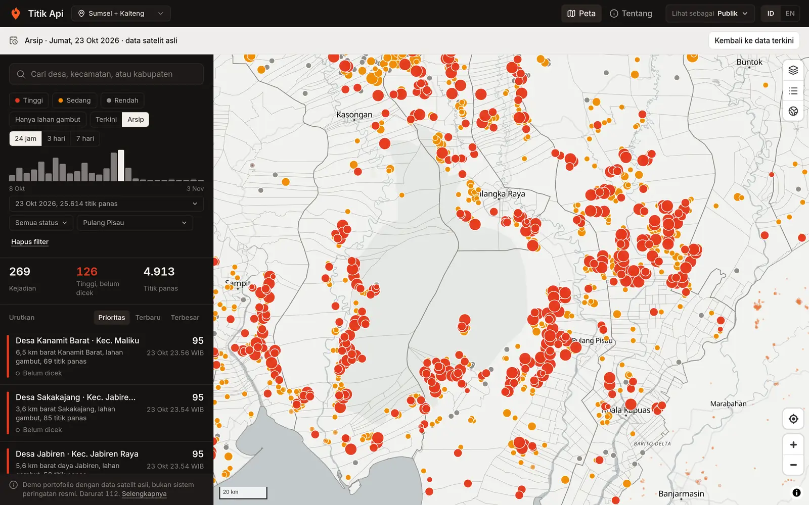
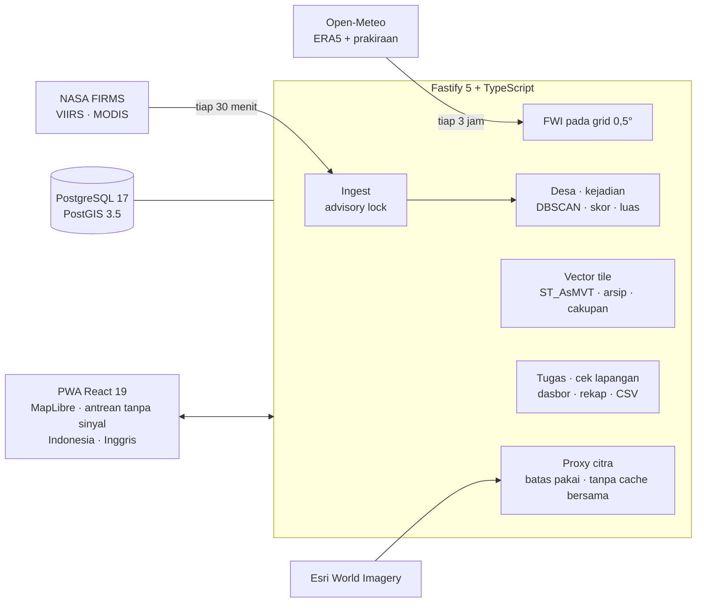

# Titik Api

Peringatan titik panas tingkat desa dari data satelit NASA untuk 4.837 desa dan kelurahan di Sumatera Selatan dan
Kalimantan Tengah: titik panas dicocokkan dengan desanya, BPBD menugaskan regu relawan terdekat, dan temuan regu
kembali ke BPBD.

**[Buka aplikasi](https://titik-api.mrramdn.com)** ·
[Putar ulang puncak kemarau, 23 Okt 2026](https://titik-api.mrramdn.com/peta?tanggal=2026-10-23) ·
[Coba sebagai BPBD](https://titik-api.mrramdn.com/dasbor?lihat=bpbd) ·
[Coba sebagai relawan](https://titik-api.mrramdn.com/tugas?lihat=mpa) ·
[English](README.md)

Demo dengan data satelit asli sejak Oktober 2026, diperbarui tiap 30 menit. Ini bukan sistem peringatan resmi dan
tidak dipakai instansi mana pun. Dibuat dan dijalankan oleh Muhamad Rifki Ramdani. Lisensi MIT.



## Yang dilakukan

| Siapa | Yang didapat |
| --- | --- |
| Publik | Peta titik panas yang dikelompokkan menjadi kejadian per desa, filter, halaman desa, arsip setiap hari sejak 8 Okt 2026, bahaya kebakaran, dan citra satelit |
| Regu Masyarakat Peduli Api (MPA) | Tugas dari BPBD lebih dulu, lalu peringatan untuk desa yang dipantau, terdekat atau paling mendesak lebih dulu, rute, dan cek lapangan yang tetap bisa diisi tanpa sinyal |
| Kepala desa | Ringkasan tujuh hari dan peringatan untuk desanya |
| BPBD dan Daops Manggala Agni | Dasbor kejadian yang perlu tindakan, penugasan ke regu terdekat, rekap harian, dan ekspor cek lapangan dalam format groundcheck SiPongi+ |

Akun demo di balik tautan "Coba" terbuka dengan satu klik. Apa yang dilakukan pengunjung di sana tetap di dalam demo:
peta publik hanya menampilkan cek lapangan dan tugas yang asli, cek lapangan demo tidak menyimpan posisi GPS, dan
semua yang dikerjakan dengan akun demo dihapus setiap malam pukul 03.00 WIB.

## Cara kerja

1. **Satelit.** Setiap 30 menit API membaca titik panas near-real-time NASA FIRMS untuk dua provinsi: VIIRS 375 m di
   NOAA-21 dan NOAA-20 (S-NPP sampai berhenti pada 2 Nov 2026) dan MODIS 1 km di Terra dan Aqua. FIRMS menerbitkan
   satu lintasan sekitar tiga jam setelah satelit melintas.
2. **Desa dan kejadian.** Setiap titik panas dicocokkan dengan poligon desanya (`ST_Contains`). Titik VIIRS yang
   berjarak ≤ 750 m pada hari WIB yang sama menjadi satu kejadian (`ST_ClusterDBSCAN`), dibatasi sel 3 km agar satu
   regu bisa mengeceknya; titik MODIS ditautkan ke kejadian VIIRS dalam jejak pikselnya. Setiap kejadian mendapat skor
   prioritas 0–100 beserta alasannya: keyakinan, daya radiasi, ukuran, gambut, jarak ke permukiman, dan pengurangan
   di dekat sumber panas tetap.
3. **Penugasan dan peringatan.** BPBD menugaskan kejadian ke regu terdekat; regu menandai "menuju lokasi". Relawan dan
   kepala desa menerima notifikasi untuk desa yang mereka pantau, dengan jarak dan arah dari permukiman terdekat, siap
   diteruskan ke WhatsApp.
4. **Cek lapangan dan rekap.** Relawan memilih satu dari lima hasil (api aktif, asap atau bara, bakar terkendali,
   alarm palsu, tidak terjangkau) dengan foto, posisi, dan catatan bila perlu. Tanpa sinyal, laporan menunggu di
   ponsel dan terkirim saat sinyal kembali. Cek lapangan menutup tugas dan masuk ke dasbor, rekap harian, dan CSV.

Lebih dari titik di peta:

- **Arsip:** hari WIB mana pun sejak 8 Okt 2026 bisa diputar ulang dengan data aslinya (`/peta?tanggal=TTTT-BB-HH`),
  lengkap dengan citra warna asli NASA hari itu. Pada 23 Okt 2026 arsip memuat 25.614 titik panas dalam 3.001 kejadian.
- **Kotak piksel:** dari zoom 11 setiap titik panas digambar sebagai perkiraan piksel satelitnya, bukan titik yang
  tepat.
- **Bahaya kebakaran:** sistem Fire Weather Index Kanada yang dihitung dari cuaca Open-Meteo pukul 12.00 WIB pada grid
  0,5°, dengan kelas FWI yang diterbitkan BMKG. Bukan produk resmi BMKG.
- **Angin dan asap:** per kejadian, angin sekarang atau saat terakhir terdeteksi, dan desa dalam radius 5 km di arah
  asap.
- **Indikasi luas area panas:** luas jejak piksel pada satu lintasan satelit, per kejadian. Bukan luas terbakar.
- **Citra HD:** Esri World Imagery saat diperbesar, diambil oleh API sehingga kuncinya tidak pernah sampai ke browser.

## Data dan akurasi

- Titik panas adalah piksel satelit dengan suhu permukaan tinggi, bukan kebakaran yang sudah pasti dan bukan lokasi
  yang tepat. Api di bawah awan, asap tebal, atau kanopi, dan api di antara dua lintasan, bisa terlewat. NASA tidak
  menyarankan data near-real-time untuk keputusan taktis ([disclaimer LANCE](https://www.earthdata.nasa.gov/data/projects/lance/disclaimer)).
- Alarm palsu dikurangi dengan menandai titik panas di dekat sumber panas tetap (kawasan industri, dan alarm palsu
  terverifikasi selama 30 hari) dan dengan tingkat keyakinan dalam skor; cek lapangan yang memastikan.
- Bahaya kebakaran: modul FWI ditulis dari Van Wagner & Pickett (1985) dan Van Wagner (1987), dengan panjang hari yang
  disesuaikan menurut lintang dari Lawson & Armitage (2008). Dijalankan pada contoh musim yang dicetak Van Wagner &
  Pickett (1985), hasilnya berselisih paling banyak 0,05 dari tabel untuk FFMC, DC, dan ISI, dan 0,1 untuk DMC, BUI,
  dan FWI. Kelas sebuah kabupaten adalah kelas yang mencakup bagian terluas wilayahnya; kelas yang lebih tinggi yang
  mencakup sedikitnya 10% ikut disebut. Cuacanya berasal dari model (riwayat ERA5 dan prakiraan lewat Open-Meteo),
  bukan dari stasiun BMKG.
- Kanal resmi: [SiPongi+](https://sipongi.gakkum.kehutanan.go.id/), [BMKG](https://spartan.bmkg.go.id/), BPBD
  setempat, dan 112 dalam keadaan darurat.

## Arsitektur



- **API** (`apps/api`): Fastify 5, TypeScript, `pg`, PostgreSQL 17 + PostGIS 3.5, sharp, web-push. Penjadwal ingest dan
  cuaca berjalan di dalam proses dengan advisory lock. Lapisan peta adalah vector tile yang dipotong PostGIS, disimpan
  per rentang waktu, hari arsip, dan cakupan penonton. Migrasi bersifat aditif dan berjalan saat start.
- **Web** (`apps/web`): React 19, React Router, MapLibre GL, vite-plugin-pwa (Workbox `injectManifest`). Halaman depan
  dimuat tanpa kode peta; layar peta dan MapLibre dimuat sebagai bagian tersendiri. Laporan yang belum terkirim
  menunggu di IndexedDB; cache yang berisi data akun dikosongkan saat akun berganti.
- **Data rujukan** (`data/`): batas desa, masker gambut, permukiman, kawasan industri, dan snapshot FIRMS sebagai
  cadangan. Sumber dan perintah pembuatannya: [`data/SOURCES.md`](data/SOURCES.md).

## Operasional

- GitHub Actions menjalankan pengecekan pada setiap push dan pull request; push ke `main` membangun image,
  mendorongnya ke GHCR, dan men-deploy commit itu menurut SHA-nya ke satu VPS (Docker Compose di belakang nginx dan
  Cloudflare) lewat satu perintah deploy yang dibatasi.
- `GET /api/v1/health` adalah pemeriksaan hidup; `GET /api/v1/health/data` menjawab 503 bila ingest sukses terakhir
  lebih dari 90 menit lalu, dan aplikasi menampilkan peringatan data tertunda setelah dua jam.
- Basis data (beserta arsip) dan foto dicadangkan setiap malam dan dipulihkan ke container sekali pakai sebelum
  cadangan disimpan. Akun demo direset pukul 03.00 WIB.
- Batas layanan pihak ketiga dijaga di kode: proxy citra berhenti di 1.000.000 tile per siklus tagihan Esri, 33.000
  sehari, dan 5.000 per alamat pengunjung sehari, lalu kembali ke Sentinel-2 cloudless; Open-Meteo dipanggil dalam
  kelompok kecil yang diberi jeda.

## Jalankan lokal

Butuh Node 24+, pnpm 12, dan Docker.

```sh
cp .env.example apps/api/.env
pnpm install
docker compose up -d --wait db          # PostGIS di 127.0.0.1:5442 (+ basis data titikapi_test)
pnpm db:migrate                         # skema dan data rujukan
pnpm --filter @titikapi/web build       # PWA ke apps/web/dist
pnpm dev:api                            # http://localhost:3000; mengisi 7 hari FIRMS dan akun demo pada start pertama
```

`pnpm dev:web` menyajikan UI dengan hot reload di http://localhost:5173 (meneruskan `/api` ke port 3000). Pengaturan
opsional ada di `.env.example`: kunci Web Push (`npx web-push generate-vapid-keys`), `ARCGIS_API_KEY` untuk citra HD,
`WEATHER_INTERVAL_MINUTES` (0 mematikan cuaca). Perintah lain: `pnpm ingest`, `pnpm db:reset-demo`,
`node --import tsx src/ingest.ts refresh <hari>` dan `node --import tsx src/weather.ts update` (di `apps/api`).

## API

Daftar rute ada di [README berbahasa Inggris](README.md#api-apiv1).

## Pengujian

`pnpm test:api` menjalankan 92 tes, sebagian besar di basis data PostGIS sungguhan: ingest dan pengelompokan, jendela
arsip, kotak piksel di tile, indikasi luas, FWI terhadap contoh musim yang diterbitkan, alur cuaca dengan data rekaman,
cakupan demo, proxy citra dan batasnya, cek lapangan tanpa sinyal, rekap, dan CSV. `pnpm test:web` menjalankan 104 tes
Vitest. Keduanya berjalan di CI pada setiap push (jumlah per 4 Nov 2026).

## Privasi

- Nama pelapor, catatan, dan foto hanya terlihat oleh akun BPBD dan relawan yang masuk, tidak pernah oleh pengunjung;
  sesi demo hanya melihatnya pada laporan demo.
- Foto disimpan ulang dan kehilangan metadata lokasinya. Posisi laporan hanya posisi yang dipilih pelapor untuk
  dikirim; laporan demo hanya menyimpan jaraknya ke titik panas.
- Titik Api tidak menampilkan pemilik lahan atau perusahaan; kawasan industri hanya diberi label jenisnya.

## Penggunaan AI

Kode, tes, dan dokumentasi ditulis dengan Claude Code (Anthropic, Claude Opus 5.5) di bawah arahan penulis; arsitektur,
pilihan data, validasi, dan operasionalnya diputuskan oleh penulis. Materi lomba juga dibuat dengan Claude, dan narasi
filmnya memakai suara sintetis Microsoft Edge TTS. Skor prioritas dan FWI adalah rumus tetap, bukan model AI.

## Riwayat

- **1.0 (versi lomba):** dibuat untuk Hackathon JOINTS UGM 2026 (Sustainability, subtema 4), dikumpulkan pada
  16 Okt 2026 dan dipresentasikan di Grand Final 1 Nov 2026 tanpa perubahan. Versi itu adalah tag `joints-2026`.
  Diikutkan atas nama tim Close AI (Universitas Bina Nusantara), sesuai syarat lomba.
- **1.1 (Nov 2026):** dirawat sebagai proyek portofolio. Lihat [CHANGELOG.md](CHANGELOG.md).

## Lisensi dan kredit

Kode: MIT (lihat `LICENSE`). Data pihak ketiga mengikuti lisensinya masing-masing; daftar lengkapnya ada di
[README berbahasa Inggris](README.md#licence-and-credits).
