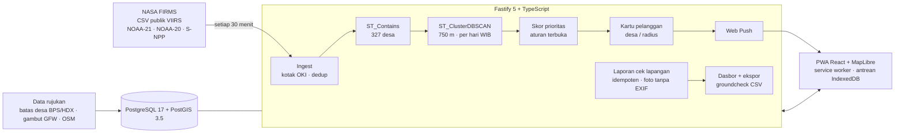

# Titik Api

**Titik panas satelit per desa, dicek warga, dibaca BPBD.**

Musim kebakaran hutan dan lahan 2026 setara dengan 2015: SiPongi+ mencatat 15.722 titik panas MODIS berkeyakinan tinggi pada September 2026, hampir sama dengan September 2015 (16.463). Pada 13 Oktober 2026 Presiden meminta pencegahan "di tingkat paling bawah, di tingkat desa". Data satelitnya sudah ada dan terbuka. Yang belum tersambung adalah jalur terakhirnya: dari titik di peta sampai ke orang yang bisa mengecek di lapangan, lalu kembali lagi ke posko.

Titik Api mengisi jalur itu untuk satu kabupaten pilot, **Ogan Komering Ilir (OKI), Sumatera Selatan**:

1. **Satelit.** Setiap 30 menit server mengambil titik panas NASA FIRMS (VIIRS 375 m) dari NOAA-21, NOAA-20, dan S-NPP, lalu menautkannya ke 327 poligon desa/kelurahan OKI.
2. **Triase.** Deteksi digabung menjadi kejadian, diberi tanda gambut dan sumber panas tetap, lalu diberi skor prioritas dengan aturan yang bisa dicek siapa pun.
3. **Kartu desa.** Relawan Masyarakat Peduli Api (MPA) dan kepala desa menerima kartu peringatan untuk desa yang mereka pantau, misalnya "3 titik panas · 1,2 km tenggara pusat Desa X · di lahan gambut · 13.42 WIB". Kartu masuk sebagai notifikasi push dan bisa diteruskan ke grup WhatsApp dengan satu ketukan.
4. **Cek lapangan, juga tanpa sinyal.** Relawan memilih satu dari lima status (api aktif, asap/bara, bakar terkendali, alarm palsu, tidak terjangkau), lalu menambah foto, GPS, dan catatan. Tanpa sinyal, laporan disimpan di ponsel dan terkirim sendiri begitu ada sinyal.
5. **Dasbor BPBD/Daops.** Persentase kejadian yang sudah dicek, median waktu dari deteksi sampai cek, prioritas tinggi yang belum disentuh, dan ekspor CSV berformat isian groundcheck SiPongi+.

Titik Api tidak menggantikan SiPongi+, Songket, atau sistem resmi lain. Titik Api menyambungkan data itu ke desa, lalu mengembalikan hasil cek lapangan dalam format yang bisa diteruskan.

> Titik panas adalah indikasi anomali suhu permukaan, bukan kepastian api. Karena itu setiap titik perlu dicek, dan "tidak ada titik" belum tentu aman.

## Hackathon JOINTS UGM 2026

- **Tim:** Close AI, Universitas Bina Nusantara
- **Tema:** Sustainability
- **Subtema 4:** Masyarakat sekitar hutan dan lahan gambut yang terdampak kebakaran dan deforestasi, sehingga sulit memantau titik api dan alih fungsi lahan sejak dini
- **Prototipe:** https://titik-api.mrramdn.com, dengan akun demo sekali ketuk di halaman Masuk

## Coba dalam dua menit

| Peran | Cara masuk | Yang bisa dicoba |
| --- | --- | --- |
| Relawan MPA | **Masuk → Relawan MPA** | Kartu peringatan, Bagikan ke WA, notifikasi push dan tombol uji, cek lapangan (coba juga dengan mode pesawat) |
| Kepala desa | **Masuk → Kepala desa** | Kartu untuk desanya dan ringkasan desa yang bisa dibagikan |
| Petugas BPBD/Daops | **Masuk → BPBD / Daops** | Dasbor, tabel per desa, umpan cek lapangan, ekspor CSV groundcheck |

Akun demo dipakai bersama dan bukan akun resmi instansi mana pun. Titik panasnya data asli NASA FIRMS. Cek lapangan dari akun demo ditandai "demo" di semua tampilan dan direset setiap malam pukul 03.00 WIB. Reset itu juga memilih ulang desa yang dipantau relawan demo, yaitu desa dengan kejadian terbanyak dalam 72 jam terakhir, supaya selalu ada titik asli untuk dicoba.

**Skenario singkat:**

1. Buka peta beranda dan lihat titik panas OKI 24 jam terakhir. Nyalakan lapisan gambut dan alert gangguan hutan.
2. Masuk sebagai relawan MPA. Buka kartu berprioritas TINGGI, lalu ketuk **Bagikan ke WA**.
3. Ketuk **Cek lapangan**. Matikan sinyal (mode pesawat, atau DevTools → Network → Offline), pilih "Asap / bara", lalu kirim. Laporan masuk antrean. Nyalakan lagi sinyalnya, dan laporan terkirim sendiri.
4. Masuk sebagai BPBD. Kejadian tadi sudah tercatat, lengkap dengan waktu dari deteksi sampai cek.

## Arsitektur



- **Backend** (`apps/api`): Fastify 5, TypeScript, `pg`, PostgreSQL 17 + PostGIS 3.5, sharp, web-push. Penjadwal ingest berjalan di dalam proses dengan advisory lock, sehingga hanya satu ingest yang berjalan pada satu waktu.
- **Frontend** (`apps/web`): React 19, React Router, MapLibre GL, dan vite-plugin-pwa (Workbox `injectManifest`). Antrean laporan disimpan di IndexedDB. Halaman, data terakhir, dan tile peta tetap terbuka tanpa sinyal.
- **Data rujukan** (`data/`): batas desa OKI, masker gambut, permukiman, kawasan industri, dan snapshot FIRMS 16 Okt 2026 sebagai cadangan. Sumber dan perintah pembuatannya ada di [`data/SOURCES.md`](data/SOURCES.md).

### Pipeline titik panas

| Langkah | Detail |
| --- | --- |
| Ambil | CSV 24 jam FIRMS (Asia Tenggara) untuk tiga satelit, disaring ke kotak OKI. Pengiriman data S-NPP berhenti 1–2 Nov 2026 (NASA Earthdata, NOAA OSPO), jadi NOAA-21/20 dipakai sejak awal. |
| Simpan | `UNIQUE (satellite, acq_at, latitude, longitude)`, sehingga ingest ulang tidak menggandakan data. |
| Tautkan | `ST_Contains` ke poligon desa; ditandai gambut (masker GFW) dan sumber panas tetap (industri OSM, atau alarm palsu yang sudah diverifikasi, dalam radius tertentu). |
| Kelompokkan | Titik yang berjarak ≤ 750 m pada hari WIB yang sama digabung menjadi satu kejadian (`ST_ClusterDBSCAN` pada koordinat UTM 48S). Kejadian lama tetap memakai ID-nya; bila tersambung, kejadian yang lebih tua menyerap yang lain beserta laporannya. |
| Skor | Keyakinan (high 30 / nominal 18 / low 6) + FRP maks (≥ 50 MW 20 · 20–50 MW 14 · 5–20 MW 8 · < 5 MW 3) + jumlah deteksi (2: 6 · 3–4: 10 · ≥ 5: 15) + gambut (20) + permukiman ≤ 1 km (15) atau ≤ 3 km (8), dikurangi 40 bila dekat sumber panas tetap. Tinggi ≥ 60, sedang 35–59. |
| Kartu | Untuk pelanggan desa itu, atau pelanggan desa lain yang radiusnya mencakup kejadian. Hanya prioritas sedang dan tinggi yang menjadi kartu. Teks kartu dibuat saat dibaca, jadi tidak pernah basi. |

## Apa bedanya dengan yang sudah ada

Kami tidak mengklaim sebagai sistem pertama yang memantau titik panas. Yang sudah ada:

- SiPongi+ menampilkan titik panas sampai nama desa, mencatat groundcheck petugas, dan menerima laporan warga.
- FIRMS mengirim peringatan email per area.
- BRIN menyaring alarm palsu.
- Songket Sumsel merutekan petugas ke titik panas.
- Sebuah skripsi IPB 2026 membuat aplikasi peringatan dini dengan laporan MPA.

Celah yang kami isi:

- **Kartu per desa yang datang sendiri** ke relawan dan kepala desa, dalam bahasa sederhana: jarak dan arah dari pusat desa, gambut atau bukan, prioritas, dan pengingat "belum tentu api".
- **Cek lapangan yang tertaut ke titik panas tertentu**, dengan lima status, dan tetap jalan tanpa sinyal.
- **Metrik waktu respons per desa**: berapa persen kejadian sudah dicek, dan berapa lama dari deteksi sampai cek.
- **Belajar dari alarm palsu**: lokasi yang diverifikasi sebagai alarm palsu ditandai selama 30 hari.
- **Api dan alih fungsi lahan dalam satu tampilan desa**, dengan lapisan alert gangguan hutan terintegrasi.
- **Ekspor berformat groundcheck SiPongi+**, supaya hasilnya bisa diteruskan ke sistem resmi.

## Jalankan lokal

Butuh Node 24+, pnpm 12, dan Docker.

```sh
cp .env.example apps/api/.env
pnpm install
docker compose up -d --wait db          # PostGIS di 127.0.0.1:5442 (+ basis data titikapi_test)
pnpm db:migrate                         # skema + data rujukan
pnpm --filter @titikapi/web build       # PWA ke apps/web/dist
pnpm dev:api                            # http://localhost:3000; mengisi 7 hari FIRMS dan akun demo pada start pertama
```

Untuk mengembangkan UI dengan hot reload, jalankan `pnpm dev:web` (http://localhost:5173, mem-proxy `/api` ke port 3000). Push butuh `VAPID_PUBLIC_KEY` dan `VAPID_PRIVATE_KEY` di `.env` (`npx web-push generate-vapid-keys`). Tanpa kunci itu, push mati dan fitur lain tetap berjalan.

Perintah lain: `pnpm ingest` (sekali tarik FIRMS), `pnpm --filter @titikapi/api ingest snapshot 7d` (pakai snapshot), dan `pnpm db:reset-demo`.

## Rute API (`/api/v1`)

| Rute | Akses | Isi |
| --- | --- | --- |
| `GET health` | publik | status basis data |
| `POST auth/demo`, `POST auth/login`, `GET auth/me`, `POST auth/logout` | publik / masuk | sesi cookie (web) atau Bearer |
| `GET villages`, `GET villages.geojson`, `GET villages/:id` | publik | desa, poligon, statistik 7 hari |
| `GET detections?hours=`, `GET incidents?hours=&level=&village=`, `GET incidents/:id` | publik | titik panas, kejadian, rincian skor; catatan dan pelapor hanya untuk yang masuk |
| `GET ingest/status` | publik | lintasan terakhir per satelit, riwayat ingest |
| `GET/PUT me/subscriptions`, `GET me/alerts`, `POST me/alerts/:id/read`, `POST me/alerts/:id/shared` | masuk | desa yang dipantau dan kartu peringatan |
| `GET push/public-key`, `POST/DELETE me/push`, `POST me/push/test` | masuk | Web Push |
| `POST incidents/:id/verifications` | MPA | laporan cek lapangan (JSON atau multipart dengan foto), idempoten lewat `clientUuid` |
| `GET dashboard?range=24h\|7d`, `GET export/groundcheck.csv` | BPBD | dasbor dan ekspor |
| `GET /k/:code` | publik | tautan bagikan dengan pratinjau kartu (Open Graph) |

## Pengujian dan CI

- `pnpm test:api`: tes integrasi dengan PostGIS sungguhan. Isinya parse CSV FIRMS, skor, teks kartu, ingest idempoten, penautan desa, penggabungan kejadian, kartu dan push, guard peran, laporan offline yang idempoten, foto tanpa EXIF, dasbor dan median, kolom CSV, pratinjau tautan, dan reset demo.
- `pnpm test:web`: Vitest untuk antrean offline (IndexedDB) dan helper jarak/arah.
- GitHub Actions (`.github/workflows/checks.yml`) menjalankan semuanya pada setiap push. `deploy.yml` membangun image, mendorongnya ke GHCR, dan memutar ulang VPS lewat perintah deploy yang dikunci.

## Deploy

Satu image Docker (`Dockerfile`) berisi API dan PWA, berjalan di VPS bersama PostGIS (`postgis/postgis:17-3.5-alpine`) di belakang nginx dan Cloudflare. Konfigurasi server ada di repo infrastruktur tim. Migrasi dan pemuatan data rujukan berjalan setiap container start. Pada basis data kosong, server mengisi 7 hari riwayat FIRMS setelah health check lolos.

## Privasi dan etika

- Nama pelapor, catatan, dan foto hanya terlihat oleh pengguna yang masuk.
- EXIF foto, termasuk lokasinya, dibuang. Koordinat laporan hanya dari GPS yang dipilih pelapor untuk dikirim (UU 27/2022 PDP).
- Titik Api tidak menampilkan pemilik lahan atau perusahaan. Kawasan industri hanya diberi label jenisnya, tanpa nama.
- "Bakar terkendali" dicatat sebagai fakta lapangan, bukan penilaian hukum.

## Penggunaan AI

Kode, tes, dokumentasi, dan materi lomba dibuat dengan bantuan Claude (Anthropic) melalui Claude Code. Narasi video memakai suara sintetis Microsoft Edge TTS. Keputusan produk, pemilihan pilot, pemeriksaan klaim, dan pengujian dilakukan tim. Daftar lengkapnya ada di lampiran pitch deck.

## Lisensi dan kredit

Kode: MIT (lihat `LICENSE`). Data pihak ketiga tetap mengikuti lisensinya masing-masing:

- **NASA FIRMS:** "We acknowledge the use of data and/or imagery from NASA's Fire Information for Resource Management System (FIRMS) (https://www.earthdata.nasa.gov/firms), part of NASA's Earth Science Data and Information System (ESDIS)."
- **Batas desa:** Indonesia Subnational Administrative Boundaries (COD-AB), BPS melalui OCHA/HDX, CC BY-IGO.
- **Gambut:** "Global peatland extent" (Miettinen dkk. 2016 untuk Indonesia), Global Nature Watch, CC BY 4.0.
- **Alert gangguan hutan:** Integrated deforestation alerts (UMD/GLAD, WUR), Global Nature Watch, CC BY 4.0.
- **Permukiman dan kawasan industri:** © kontributor OpenStreetMap, ODbL.
- **Peta dasar:** OpenFreeMap, © OpenMapTiles, © kontributor OpenStreetMap.
- **Citra:** Sentinel-2 cloudless 2023 oleh EOX IT Services GmbH (CC BY-NC-SA 4.0), berisi data Copernicus Sentinel yang dimodifikasi.
