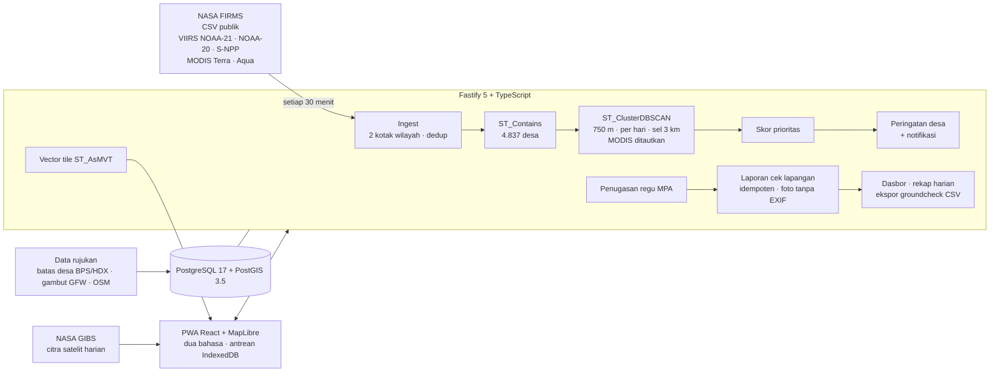

# Titik Api

Peringatan titik panas tingkat desa untuk pengendalian kebakaran hutan dan lahan di Sumatera Selatan dan Kalimantan Tengah.

Aplikasi: https://titik-api.mrramdn.com · [English](README.en.md)

Titik Api meneruskan titik panas NASA FIRMS ke relawan Masyarakat Peduli Api (MPA) dan kepala desa yang memantau desa terkait. Hasil cek lapangan mereka tercatat dan tampil di dasbor BPBD dan Daops Manggala Agni.

Cakupan: Sumatera Selatan dan Kalimantan Tengah, 4.837 desa/kelurahan di 31 kabupaten/kota. Wilayah pilot: Kabupaten Ogan Komering Ilir (OKI).

## Cara kerja

1. **Data satelit.** Server memeriksa NASA FIRMS setiap 30 menit: VIIRS 375 m (NOAA-21, NOAA-20, S-NPP) dan MODIS 1 km (Terra, Aqua). Titik panas baru tersedia setelah lintasan satelit. VIIRS melintas sekitar 00.00–02.30 dan 12.00–14.40 WIB, Terra 07.30–09.10 dan 19.30–21.30 WIB, Aqua 14.40–16.20 dan 02.30–04.30 WIB. FIRMS merilis data paling lambat sekitar 3 jam setelah lintasan.
2. **Kejadian dan prioritas.** Titik panas VIIRS berjarak ≤ 750 m pada hari yang sama digabung menjadi satu kejadian, dibatasi sel 3 km agar satu kejadian tetap bisa dicek satu regu. Titik MODIS ditautkan ke kejadian VIIRS terdekat. Titik MODIS tanpa pasangan VIIRS menjadi kejadian tersendiri dengan lokasi ±1 km. Setiap kejadian mendapat skor prioritas 0–100.
3. **Peringatan desa.** Relawan MPA dan kepala desa menerima peringatan untuk desa yang mereka pantau, lengkap dengan jarak dan arah dari permukiman terdekat. Peringatan dikirim sebagai notifikasi dan dapat diteruskan ke WhatsApp beserta tautan lokasi.
4. **Penugasan.** BPBD/Daops menugaskan kejadian ke regu MPA terdekat. Regu menandai "menuju lokasi", dan laporan cek lapangan menutup tugas.
5. **Cek lapangan.** Relawan memilih satu dari lima status: api aktif, asap atau bara, bakar terkendali, alarm palsu, atau tidak terjangkau. Foto, koordinat GPS, dan catatan dapat dilampirkan. Tanpa sinyal, laporan disimpan di ponsel dan dikirim otomatis saat sinyal tersedia.
6. **Dasbor dan rekap.** BPBD/Daops melihat kejadian yang perlu tindakan, yang sedang ditangani, dan yang sudah dicek, beserta waktu tanggap. Rekap harian per kabupaten dapat dibagikan atau dicetak. Hasil cek lapangan dapat diekspor ke CSV sesuai isian groundcheck SiPongi+.

Titik Api melengkapi SiPongi+ dan Songket. Hasil cek lapangan diekspor dalam format groundcheck SiPongi+ agar dapat diteruskan ke sistem resmi.

> Titik panas menandai suhu permukaan tinggi yang terdeteksi satelit dan perlu dicek di lapangan. Api di bawah awan, asap tebal, atau kanopi dapat tidak terdeteksi.

## Peran

| Peran | Yang dilihat dan dikerjakan |
| --- | --- |
| Publik | Peta kejadian, filter, halaman desa, citra satelit harian |
| Relawan MPA | Tugas dari BPBD/Daops, peringatan desa yang diurutkan menurut prioritas atau jarak, rute ke lokasi, cek lapangan tanpa sinyal |
| Kepala desa | Ringkasan desa yang dipantau dan peringatan untuk desanya |
| BPBD/Daops | Dasbor per kabupaten, penugasan regu, rekap harian, ekspor CSV |

Peran dipilih lewat "Lihat sebagai" di bilah atas. Akun demo dipakai bersama dan bukan akun resmi instansi. Laporan dari akun demo ditandai "demo" dan dihapus setiap malam pukul 03.00 WIB. Bahasa dapat diganti antara Indonesia dan Inggris.

## Arsitektur



- **Backend** (`apps/api`): Fastify 5, TypeScript, `pg`, PostgreSQL 17 + PostGIS 3.5, sharp, web-push. Penjadwal ingest berjalan di dalam proses dengan advisory lock, sehingga hanya satu ingest yang berjalan pada satu waktu. Peta memakai vector tile yang dipotong PostGIS (`ST_AsMVT`).
- **Frontend** (`apps/web`): React 19, React Router, MapLibre GL, dan vite-plugin-pwa (Workbox `injectManifest`), dalam bahasa Indonesia dan Inggris. Laporan yang belum terkirim disimpan di IndexedDB. Halaman, data terakhir, dan tile peta tetap terbuka tanpa sinyal.
- **Data rujukan** (`data/`): batas desa dua provinsi, masker gambut per provinsi, permukiman, kawasan industri, dan snapshot FIRMS 16 Okt 2026 (VIIRS dan MODIS) sebagai cadangan. Sumber dan perintah pembuatannya ada di [`data/SOURCES.md`](data/SOURCES.md).

### Pipeline titik panas

| Langkah | Detail |
| --- | --- |
| Ambil | CSV FIRMS Asia Tenggara untuk VIIRS (NOAA-21, NOAA-20, S-NPP) dan MODIS (Terra, Aqua), disaring ke kotak Sumatera Selatan dan Kalimantan Tengah. Pengiriman data S-NPP berhenti pada 2 Nov 2026 (NASA Earthdata, NOAA OSPO). Terra dan Aqua dijadwalkan berhenti bertahap mulai akhir 2026. |
| Simpan | `UNIQUE (satellite, acq_at, latitude, longitude)`, sehingga ingest ulang tidak menggandakan data. Keyakinan MODIS (0–100) disimpan apa adanya dan dipetakan ke rendah (< 30), sedang (30–79), dan tinggi (≥ 80). |
| Tautkan | `ST_Contains` ke poligon desa. Titik ditandai bila berada di lahan gambut (masker GFW) atau dekat sumber panas tetap (kawasan industri OSM, atau lokasi alarm palsu terverifikasi selama 30 hari). |
| Kelompokkan | Titik VIIRS berjarak ≤ 750 m pada hari WIB yang sama digabung menjadi satu kejadian (`ST_ClusterDBSCAN` pada koordinat Web Mercator, dipartisi per hari dan per sel 3 km). Titik MODIS ditautkan ke kejadian VIIRS dalam jejak pikselnya. Kejadian lama tetap memakai ID-nya. Bila tersambung, kejadian yang lebih tua menyerap yang lain beserta laporan dan tugasnya. |
| Skor | Keyakinan VIIRS (tinggi 30, sedang 18, rendah 6), FRP maksimum (≥ 50 MW 20, 20–50 MW 14, 5–20 MW 8, < 5 MW 3), jumlah titik VIIRS (2: 6, 3–4: 10, 5–19: 15, ≥ 20: 20), lahan gambut 20, permukiman ≤ 1 km 15 atau ≤ 3 km 8, terkonfirmasi MODIS 5, dikurangi 40 bila dekat sumber panas tetap. Kejadian khusus MODIS memakai bobot lebih rendah. Tinggi ≥ 60, sedang 35–59. |
| Peringatan | Untuk pemantau desa itu, atau desa lain yang radiusnya mencakup kejadian. Hanya prioritas sedang dan tinggi yang menjadi peringatan. Notifikasi dikirim sekali per ingest per pengguna. |

## Jalankan lokal

Butuh Node 24+, pnpm 12, dan Docker.

```sh
cp .env.example apps/api/.env
pnpm install
docker compose up -d --wait db          # PostGIS di 127.0.0.1:5442 (+ basis data titikapi_test)
pnpm db:migrate                         # skema + data rujukan
pnpm --filter @titikapi/web build       # PWA ke apps/web/dist
pnpm dev:api                            # http://localhost:3000; mengisi 7 hari FIRMS dan akun demo pada start pertama
```

Untuk mengembangkan UI dengan hot reload, jalankan `pnpm dev:web` (http://localhost:5173, meneruskan `/api` ke port 3000). Notifikasi butuh `VAPID_PUBLIC_KEY` dan `VAPID_PRIVATE_KEY` di `.env` (`npx web-push generate-vapid-keys`). Tanpa kunci itu, notifikasi mati dan fitur lain tetap berjalan.

Perintah lain: `pnpm ingest` (satu kali tarik FIRMS), `pnpm --filter @titikapi/api ingest snapshot 7d` (pakai snapshot), dan `pnpm db:reset-demo`.

## Rute API (`/api/v1`)

| Rute | Akses | Isi |
| --- | --- | --- |
| `GET health` | publik | status basis data |
| `POST auth/demo`, `POST auth/login`, `GET auth/me`, `POST auth/logout` | publik / masuk | sesi cookie (web) atau Bearer |
| `GET regions`, `GET regions/summary`, `GET summary` | publik | provinsi dan kabupaten, ringkasan per kabupaten, angka ringkas |
| `GET villages?q=&province=`, `GET villages/:id` | publik | cari desa, poligon, dan statistik 7 hari |
| `GET tiles/{desa,kabupaten,kejadian,deteksi}/:z/:x/:y` | publik | vector tile (MVT) untuk peta |
| `GET incidents?hours=&level=&status=&peat=&province=&regency=&sort=`, `GET incidents/:id` | publik | kejadian, rincian skor, dan riwayatnya; catatan, foto, dan nama pelapor hanya untuk pengguna yang masuk |
| `GET ingest/status` | publik | lintasan terakhir dan berikutnya per satelit, pemeriksaan terakhir |
| `GET/PUT me/subscriptions`, `GET me/alerts`, `POST me/alerts/:id/read`, `POST me/alerts/:id/shared` | masuk | desa yang dipantau dan peringatan |
| `GET push/public-key`, `POST/DELETE me/push`, `POST me/push/test` | masuk | notifikasi |
| `GET me/assignments`, `PATCH assignments/:id` | relawan MPA | tugas dan status "menuju lokasi" |
| `POST incidents/:id/verifications` | relawan MPA | laporan cek lapangan (JSON atau multipart dengan foto), idempoten lewat `clientUuid` |
| `GET assignees`, `POST incidents/:id/assignments`, `PATCH assignments/:id` | BPBD/Daops | pilihan regu, penugasan, pembatalan |
| `GET dashboard`, `GET recap`, `GET export/groundcheck.csv` | BPBD/Daops | dasbor, rekap harian, ekspor |
| `GET /k/:code` | publik | tautan bagikan dengan pratinjau (Open Graph) |

## Pengujian dan CI

- `pnpm test:api`: tes integrasi dengan PostGIS sungguhan. Isinya mencakup parse CSV VIIRS dan MODIS, skor, teks peringatan, ingest idempoten, pengelompokan dan penggabungan kejadian, penugasan, peringatan dan notifikasi, guard peran, laporan tanpa sinyal yang idempoten, foto tanpa EXIF, dasbor, rekap, kolom CSV, pratinjau tautan, dan reset demo.
- `pnpm test:web`: Vitest untuk antrean tanpa sinyal (IndexedDB), helper jarak dan arah, format dua bahasa, dan kelengkapan kamus.
- GitHub Actions (`.github/workflows/checks.yml`) menjalankan semuanya pada setiap push. `deploy.yml` membangun image, mendorongnya ke GHCR, dan memutar ulang VPS lewat perintah deploy yang dikunci.

## Deploy

Satu image Docker (`Dockerfile`) berisi API dan PWA, berjalan di VPS bersama PostGIS (`postgis/postgis:17-3.5-alpine`) di belakang nginx dan Cloudflare. Migrasi dan pemuatan data rujukan berjalan setiap container start. Pada basis data kosong, server mengisi 7 hari riwayat FIRMS setelah health check lolos.

## Privasi dan etika

- Nama pelapor, catatan, dan foto hanya terlihat oleh pengguna yang masuk.
- Data lokasi di dalam foto (EXIF) dibuang. Koordinat laporan hanya berasal dari GPS yang dipilih pelapor untuk dikirim (UU 27/2022 tentang Pelindungan Data Pribadi).
- Titik Api tidak menampilkan pemilik lahan atau perusahaan. Kawasan industri hanya diberi label jenisnya.
- "Bakar terkendali" dicatat sebagai fakta lapangan, bukan penilaian hukum.

## Penggunaan AI

Kode, tes, dokumentasi, desain Figma, dan materi lomba dibuat dengan bantuan Claude (Anthropic, model Claude Opus 5.5) melalui Claude Code. Narasi video memakai suara sintetis Microsoft Edge TTS. Skor prioritas memakai rumus tetap, tanpa model AI. Daftar lengkapnya ada di pitch deck.

## Lisensi dan kredit

Kode: MIT (lihat `LICENSE`). Data pihak ketiga tetap mengikuti lisensinya masing-masing:

- **NASA FIRMS:** "We acknowledge the use of data and/or imagery from NASA's Fire Information for Resource Management System (FIRMS) (https://www.earthdata.nasa.gov/firms), part of NASA's Earth Science Data and Information System (ESDIS)." MODIS: MCD14DL C6.1 NRT (doi:10.5067/FIRMS/MODIS/MCD14DL.NRT.0061).
- **Citra satelit harian:** NASA EOSDIS Global Imagery Browse Services (GIBS), VIIRS dan MODIS Corrected Reflectance.
- **Batas desa:** Indonesia Subnational Administrative Boundaries (COD-AB), BPS melalui OCHA/HDX, CC BY-IGO.
- **Gambut:** "Global peatland extent" (Miettinen dkk. 2016 untuk Indonesia), Global Nature Watch, CC BY 4.0.
- **Peringatan gangguan hutan:** Integrated deforestation alerts (UMD/GLAD, WUR), Global Nature Watch, CC BY 4.0.
- **Permukiman dan kawasan industri:** © kontributor OpenStreetMap, ODbL.
- **Peta dasar:** OpenFreeMap, © OpenMapTiles, © kontributor OpenStreetMap.
- **Citra detail:** Sentinel-2 cloudless 2023 oleh EOX IT Services GmbH (CC BY-NC-SA 4.0), berisi data Copernicus Sentinel yang dimodifikasi.

## Informasi lomba

- Hackathon JOINTS UGM 2026, tema Sustainability, subtema 4: masyarakat sekitar hutan dan lahan gambut yang terdampak kebakaran dan deforestasi, sehingga sulit memantau titik api dan alih fungsi lahan sejak dini.
- Tim Close AI, Universitas Bina Nusantara.
- Periode pengerjaan: 12–16 Oktober 2026.
