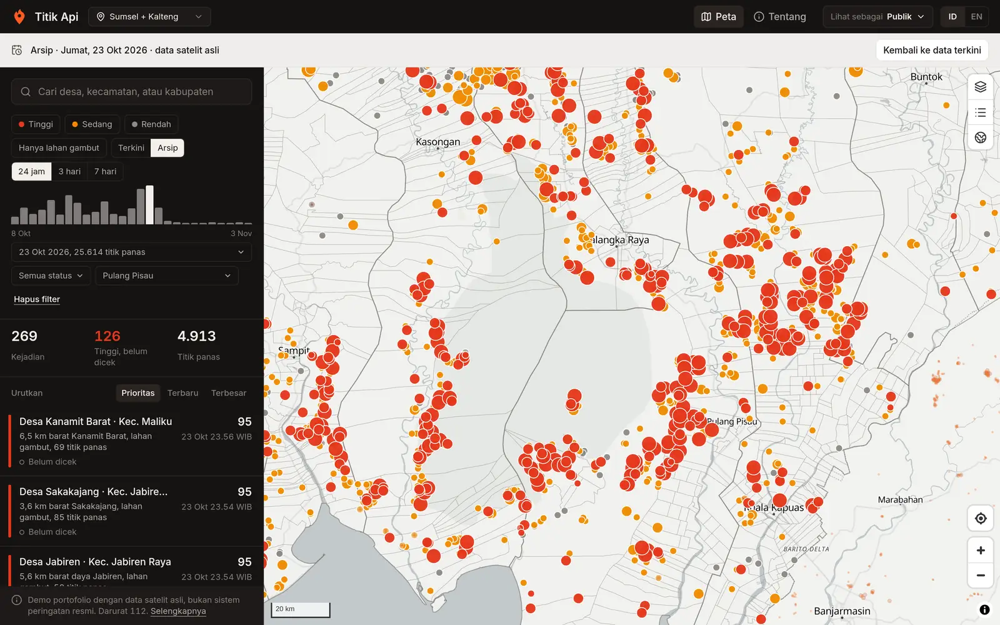
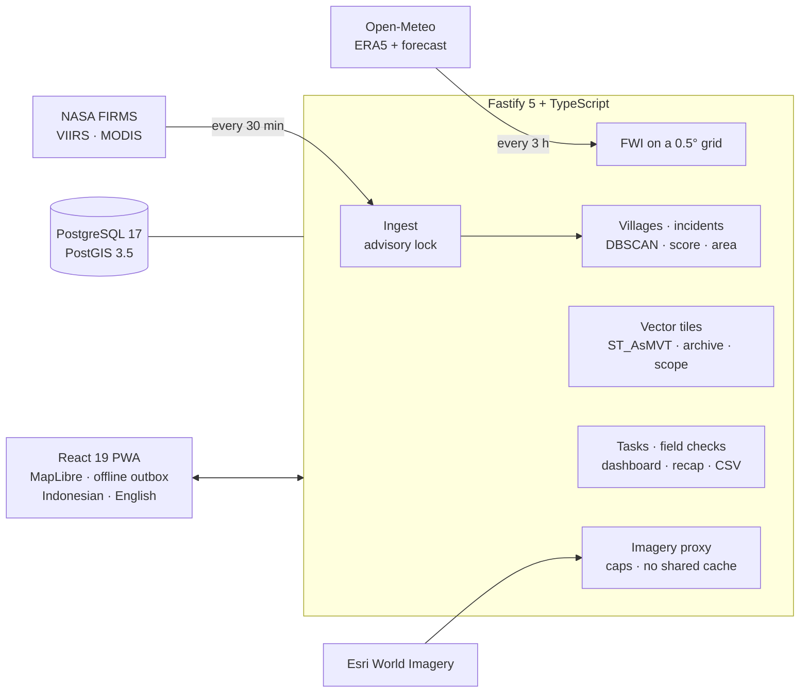

# Titik Api

Village-level hotspot alerts from NASA satellite data for 4,837 villages in South Sumatra and Central Kalimantan,
Indonesia: the hotspot is matched to its village, the regional disaster agency sends the nearest volunteer squad, and
what the squad finds comes back to the agency.

**[Open the app](https://titik-api.mrramdn.com)** ·
[Replay the dry-season peak, 23 Oct 2026](https://titik-api.mrramdn.com/?tanggal=2026-10-23) ·
[Try it as the agency](https://titik-api.mrramdn.com/dasbor?lihat=bpbd) ·
[Try it as a volunteer](https://titik-api.mrramdn.com/tugas?lihat=mpa) ·
[Bahasa Indonesia](README.id.md)

Live demo with real satellite data since October 2026, refreshed every 30 minutes. It is not an official warning
system and no agency uses it. Built and operated by Muhamad Rifki Ramdani. MIT licence.



## What it does

| Who | What they get |
| --- | --- |
| Public | A map of hotspots grouped into incidents per village, filters, village pages, the archive of every day since 8 Oct 2026, fire danger and satellite imagery |
| Volunteer squads (Masyarakat Peduli Api, MPA) | Tasks from the agency first, then alerts for the villages they watch, nearest or most urgent first, a route, and a field check that works without signal |
| Village heads | A seven-day summary and alerts for their villages |
| Disaster agency and forestry brigade (BPBD, Daops Manggala Agni) | A dashboard of incidents that need action, assignment to the nearest squad, a daily recap, and field checks exported in the SiPongi+ groundcheck format |

The shared demo accounts behind "Try it" open with one click. What visitors do there stays inside the demo: the public
map shows only real field checks and tasks, demo checks store no GPS position, and everything done with the demo
accounts is deleted every night at 03.00 WIB.

## How it works

1. **Satellites.** Every 30 minutes the API reads NASA FIRMS near-real-time hotspots for the two provinces: VIIRS
   375 m on NOAA-21 and NOAA-20 (S-NPP until it stopped on 2 Nov 2026) and MODIS 1 km on Terra and Aqua. FIRMS
   publishes a pass about three hours after the satellite flies over.
2. **Villages and incidents.** Each hotspot is matched to its village polygon (`ST_Contains`). VIIRS hotspots within
   750 m on the same WIB day form an incident (`ST_ClusterDBSCAN`), split by 3 km cells so one squad can check it;
   MODIS hotspots join the VIIRS incident whose pixel they fall in. Every incident gets a priority score from 0 to 100
   with its reasons: confidence, radiative power, size, peat, distance to settlements, and a penalty near fixed heat
   sources.
3. **Assignment and alerts.** The agency assigns an incident to the nearest squad; the squad marks itself on the way.
   Volunteers and village heads get push notifications for the villages they watch, with distance and direction from
   the nearest settlement, ready to forward to WhatsApp.
4. **Field check and recap.** A volunteer picks one of five results (active fire, smoke or embers, controlled burn,
   false alarm, unreachable) with an optional photo, position and note. Without signal the report waits on the phone
   and goes out when signal returns. The check closes the task and lands in the dashboard, the daily recap and the CSV.

Beyond the dots:

- **Archive:** any WIB day since 8 Oct 2026 replays with the real data (`/peta?tanggal=YYYY-MM-DD`), with that day's
  NASA true-colour image. On 23 Oct 2026 the archive holds 25,614 hotspots in 3,001 incidents.
- **Pixel boxes:** from zoom 11 each hotspot is drawn as its approximate satellite pixel, not a precise point.
- **Fire danger:** the Canadian Fire Weather Index System computed from Open-Meteo weather at 12.00 WIB on a 0.5°
  grid, classed with BMKG's published FWI classes. Not an official BMKG product.
- **Wind and smoke:** per incident, the wind now or at its last detection, and the villages within 5 km downwind.
- **Indicated hot area:** the area of the pixel footprints of one satellite pass, per incident. Not burned area.
- **HD imagery:** Esri World Imagery at close zoom, fetched by the API so the key never reaches a browser.

## Data and accuracy

- A hotspot is a satellite pixel with a high surface temperature, not a confirmed fire and not an exact location.
  Fires under cloud, thick smoke or canopy, and fires between passes, can be missed. NASA advises against using
  near-real-time data for tactical decisions ([LANCE disclaimer](https://www.earthdata.nasa.gov/data/projects/lance/disclaimer)).
- False alarms are reduced by flagging hotspots near fixed heat sources (industrial sites, verified false alarms for
  30 days) and by the confidence in the score; the field check is what settles it.
- Fire danger: the FWI module is written from Van Wagner & Pickett (1985) and Van Wagner (1987), with the
  latitude-adjusted day lengths of Lawson & Armitage (2008). Run on the sample season printed in Van Wagner & Pickett
  (1985) it stays within 0.05 of the table for FFMC, DC and ISI and within 0.1 for DMC, BUI and FWI. A regency's
  class is the class covering the largest share of its area; a higher class covering at least 10% is named as well.
  The weather comes from a model (ERA5 history and forecasts through Open-Meteo), not from BMKG stations.
- Official channels: [SiPongi+](https://sipongi.gakkum.kehutanan.go.id/), [BMKG](https://spartan.bmkg.go.id/), the
  local BPBD, and 112 in an emergency.

## Architecture



- **API** (`apps/api`): Fastify 5, TypeScript, `pg`, PostgreSQL 17 + PostGIS 3.5, sharp, web-push. The ingest and
  weather schedulers run in-process under advisory locks. Map layers are vector tiles cut by PostGIS, cached per
  window, archive day and viewer scope. Migrations are additive and run at start.
- **Web** (`apps/web`): React 19, React Router, MapLibre GL, vite-plugin-pwa (Workbox `injectManifest`). The landing
  page loads without the map code; the map screen and MapLibre load as their own chunks. Unsent reports wait in
  IndexedDB; caches that hold account data are emptied when the account changes.
- **Reference data** (`data/`): village boundaries, peat masks, settlements, industrial sites and a FIRMS snapshot as
  a fallback. Sources and build commands: [`data/SOURCES.md`](data/SOURCES.md).

## Operations

- GitHub Actions runs the checks on every push and pull request; a push to `main` builds the image, pushes it to GHCR
  and deploys that commit by its SHA to a single VPS (Docker Compose behind nginx and Cloudflare) through one
  restricted deploy command.
- `GET /api/v1/health` is the liveness check; `GET /api/v1/health/data` answers 503 when the last successful ingest is
  more than 90 minutes old, and the app shows a stale-data warning after two hours.
- The database (with the archive) and the photos are backed up every night and restored into a throwaway container
  before a backup is kept. The demo accounts are reset at 03.00 WIB.
- Third-party limits are enforced in code. The imagery proxy stops at 1,000,000 tiles per Esri billing cycle, 33,000
  a day and 5,000 per visitor address a day, keeps the last quarter of each day for visitors with fewer than 300 tiles
  that day, and falls back to Sentinel-2 cloudless. Wind lookups stay within 60 Open-Meteo calls a minute and 2,000 a
  day, of which lookups for older incidents may use half; the weather is fetched in small, paced blocks.
- Every rate limit counts an IPv6 client by its /64. Two gates keep database connections free for sign-in, forms and
  the health check: uncached map tiles run at most four queries at a time and the heavy reads (incident lists, counts,
  village pages, the dashboard, the recap and the CSV) at most three, each with places per address (tiles also per
  IPv6 /56). Requests for the same tile share one query, and a tile the map has cancelled leaves the line. Past the
  limits a request gets 503 or 429 with `Retry-After`, and the app asks again by itself.
- A deploy stops a running FIRMS ingest or weather update within seconds: the ingest rolls back and the next pull
  fetches it again, the weather keeps the blocks it has saved. After a rollback to `joints-2026` and back, a check at
  start-up moves what the old version wrote with the demo accounts back into the demo scope, including the fixed heat
  sources its demo false alarms added.

## Run locally

Requires Node 24+, pnpm 12 and Docker.

```sh
cp .env.example apps/api/.env
pnpm install
docker compose up -d --wait db          # PostGIS on 127.0.0.1:5442 (+ the titikapi_test database)
pnpm db:migrate                         # schema and reference data
pnpm --filter @titikapi/web build       # the PWA into apps/web/dist
pnpm dev:api                            # http://localhost:3000; loads 7 days of FIRMS and the demo accounts on first start
```

`pnpm dev:web` serves the UI with hot reload on http://localhost:5173 (it proxies `/api` to port 3000). Optional
settings in `.env.example`: Web Push keys (`npx web-push generate-vapid-keys`), `ARCGIS_API_KEY` for HD imagery,
`WEATHER_INTERVAL_MINUTES` (0 turns the weather off). Other commands: `pnpm ingest`, `pnpm db:reset-demo`,
`node --import tsx src/ingest.ts refresh <days>` and `node --import tsx src/weather.ts update` (in `apps/api`).

## API (`/api/v1`)

| Route | Access | Returns |
| --- | --- | --- |
| `GET health`, `GET health/data` | public | liveness; data freshness |
| `GET config` | public | whether HD imagery is on, and its credits |
| `GET tiles/{desa,kabupaten,kejadian,deteksi}/:z/:x/:y?hours=&tanggal=` | public | vector tiles; `deteksi` carries pixel boxes from zoom 11 |
| `GET imagery/:z/:y/:x` | this site only | Esri World Imagery through the proxy |
| `GET incidents?hours=&level=&status=&peat=&province=&regency=&sort=&tanggal=`, `GET incidents/:id`, `GET incidents/:id/wind` | public | incidents with score parts, history and indicated area; wind and downwind villages |
| `GET summary`, `GET regions`, `GET regions/summary`, `GET archive/days` | public | counts, regions, regency bubbles, the archive's days |
| `GET risk?tanggal=` | public | fire danger per grid cell and per regency |
| `GET villages?q=`, `GET villages/:id` | public | village search, polygon and seven-day statistics |
| `GET ingest/status` | public | last and next pass per satellite |
| `POST auth/demo`, `POST auth/login`, `GET auth/me`, `POST auth/logout` | public / signed in | cookie session (web) or bearer token |
| `GET/PUT me/subscriptions`, `GET me/alerts`, `GET me/assignments`, `PATCH assignments/:id` | signed in | watched villages, alerts, tasks |
| `POST incidents/:id/verifications` | volunteer | field check (JSON or multipart with a photo), idempotent by `clientUuid` |
| `GET assignees`, `POST incidents/:id/assignments`, `GET dashboard`, `GET recap`, `GET export/groundcheck.csv` | agency | squads, assignment, dashboard, daily recap, CSV |
| `GET /k/:code` | public | share link with a preview |

## Tests

`pnpm test:api` runs 136 tests, most against a real PostGIS database: ingest and clustering, stopping on shutdown, the
archive window, pixel boxes in tiles, the tile cache and both gates, the indicated area, the FWI against the published
sample season, the weather pipeline with recorded fixtures, the wind budget, the demo scope, the imagery proxy and its
caps, field checks without signal, the recap and the CSV. `pnpm test:web` runs 186 Vitest tests, some rendering
screens in happy-dom. Both run in CI on every push (counts as of 4 Nov 2026).

## Privacy

- Reporter names, notes and photos are shown only to signed-in agency and volunteer accounts, never to visitors; a
  demo session sees them only on demo reports.
- Photos are re-encoded and lose their location metadata. A report's position is only the one the reporter chose to
  send; demo reports keep only a rounded distance to the hotspot.
- The API's request log holds no visitor addresses. The web server's access log keeps the address, time, page,
  referrer and browser of each request for 14 days, for security and troubleshooting. The site is served through
  Cloudflare, which also processes addresses to deliver and protect it.
- No tracking or analytics cookies, so no cookie banner: the only cookie keeps a signed-in session. Language, filters,
  the last GPS fix, data for use without signal and unsent reports stay in the browser.
- Titik Api does not show land owners or companies; industrial sites carry only their type.

## Use of AI

Code, tests and documentation were written with Claude Code (Anthropic, Claude Opus 5.5) under the author's
direction; the author decided the architecture, data choices, validation and operations. The competition materials
were also made with Claude, and the film's narration uses the synthetic voice of Microsoft Edge TTS. The priority
score and the FWI are fixed formulas, not AI models.

## History

- **1.0 (competition version):** built for Hackathon JOINTS UGM 2026 (Sustainability, subtheme 4), submitted on
  16 Oct 2026 and presented at the Grand Final on 1 Nov 2026 without changes. That version is the tag `joints-2026`.
  Entered as team Close AI (BINUS University), as the competition required.
- **1.1 (Nov 2026):** maintained as a portfolio project. See [CHANGELOG.md](CHANGELOG.md).

## Licence and credits

Code: MIT (see `LICENSE`). Third-party data keeps its own licence:

- **NASA FIRMS:** "We acknowledge the use of data and/or imagery from NASA's Fire Information for Resource Management
  System (FIRMS) (https://www.earthdata.nasa.gov/firms), part of NASA's Earth Science Data and Information System
  (ESDIS)." MODIS MCD14DL C6.1 NRT (doi:10.5067/FIRMS/MODIS/MCD14DL.NRT.0061).
- **Daily satellite images:** NASA EOSDIS Global Imagery Browse Services (GIBS).
- **Weather:** [Open-Meteo.com](https://open-meteo.com/) (CC BY 4.0); history from ERA5. Generated using or contains
  modified Copernicus Climate Change Service information 2026. Neither the European Commission nor ECMWF is
  responsible for any use that may be made of the Copernicus information or data it contains.
- **Fire danger classes:** BMKG's published FWI classes (rendah 0–1, sedang 2–6, tinggi 7–13, sangat tinggi above 13).
- **Village boundaries:** BPS through OCHA/HDX (CC BY-IGO). **Peat:** Global peatland extent, Global Nature Watch
  (CC BY 4.0). **Forest disturbance alerts:** UMD/GLAD, WUR via Global Nature Watch (CC BY 4.0).
- **Settlements and industrial sites:** © OpenStreetMap contributors (ODbL). **Base map:** OpenFreeMap, © OpenMapTiles.
- **Imagery:** EOxCloudless [https://cloudless.eox.at](https://cloudless.eox.at) by
  [EOX IT Services GmbH](https://eox.at) (Contains modified Copernicus Sentinel data 2023), CC BY-NC-SA 4.0. Powered
  by Esri, World Imagery: Esri, Vantor, Earthstar Geographics and the GIS User Community (the full provider list comes
  from the service).
